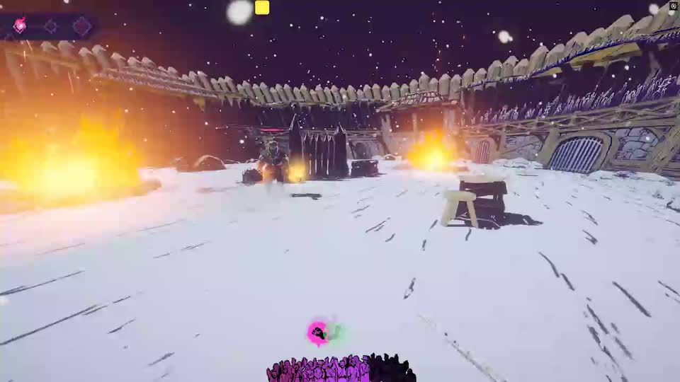
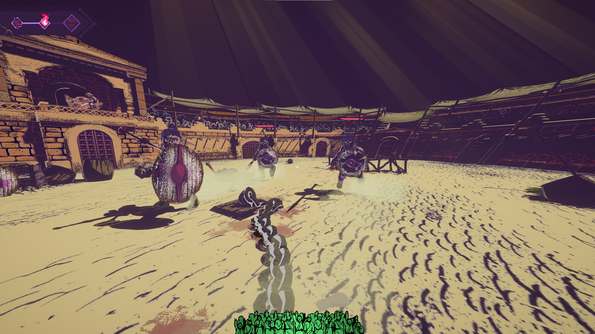
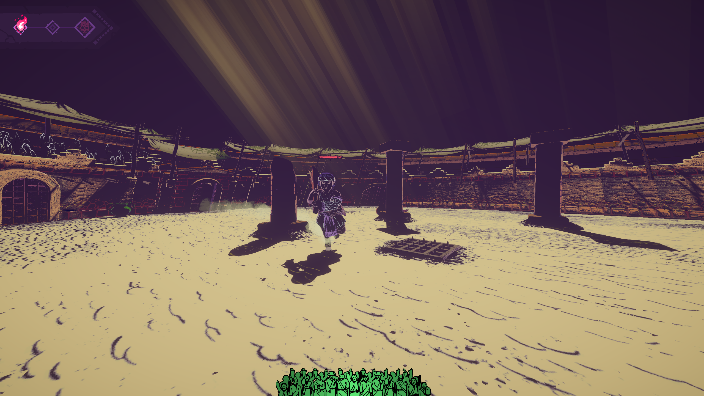

# Chained Beasts: FPS Mod

Ever wanted to make being dragged around by a chain even more disorienting?

FPS Mod adds a first-person camera to **Chained Beasts**. Press **F9** to switch it on, then press it again to go back to the normal third-person view. Move with your usual controls and use the mouse to look around.

**This is a shitpost.** Mouse and keyboard only. It's janky, and I don't plan to fix any issues.

**Current version:** 0.1.1 · **Supported Steam build:** 26231777

**[Download FPS Mod v0.1.1](https://github.com/Krrrrrrk/Chained-Beasts_FPS-Mod/releases/tag/v0.1.1)**

## What does it do?

- Puts the camera at your beast's eye level, following the animated head's position
- Adds mouse look and movement relative to where you're looking
- Hides your head, torso, limbs, and body cosmetics locally so they don't fill the screen
- Keeps equipment under the usual hand, bow, and back attachments visible
- Stays in first person during pickups, knockdowns, and other temporary action locks
- Adds a small crosshair and a toggle back to the normal camera

The camera keeps a level horizon instead of rolling around with the head animation. Looking up and down moves the camera, but attacks and throws still follow the game's normal horizontal combat rules. There aren't any custom first-person hand animations.

## How to use it

### Keyboard and mouse

Enter an arena and press **F9** to turn first person on. Press it again to turn it off. The game starts in third person by default.

Use the mouse to look around. Your usual movement controls now move you relative to the direction you're looking.

When you pick something up or get knocked over, you can keep looking around. Your look direction stays where you left it when control returns. The game still decides when you can move and act, so staying in first person doesn't let you skip those action locks.

### When does it switch back?

Menus, pause, death, executions, boss cinematics, round results, scene changes, and tabbing out return you to the normal camera. First person resumes when you're back in arena play, with the view level and facing the way your character is facing.

F9 can turn first person off while it's waiting to resume too.

## Eye Level potion with TC

I also added **Eye Level** to [Terms & Contusions](https://github.com/Krrrrrrk/chained-beasts-mod-foundation). It puts you in first person for the next battle. TC has its own potion camera support, so FPS Mod is optional.

If you install TC too, choose a mode in **TC Content** and Save before a run: **F9 SWITCHING** enables manual switching and locks Eye Level offers off; **POTION ONLY** disables F9 and locks the potion on in the offer pool. The potion card can't be toggled separately. TC includes both modes even without this standalone mod. In multiplayer, the host's mode temporarily controls the party. FPS Mod on its own keeps its normal F9 behavior.

[](https://github.com/Krrrrrrk/chained-beasts-mod-foundation/releases/download/v1.1.0/Eye_Level.mp4)

[Watch the Eye Level gameplay video (MP4)](https://github.com/Krrrrrrk/chained-beasts-mod-foundation/releases/download/v1.1.0/Eye_Level.mp4)

## Screenshots

**Personal space is apparently optional.**



**A perfectly reasonable way to play this game.**



## Installation

This build is for **Chained Beasts 1.0.2**, Steam build **26231777**, on 64-bit Windows.

1. Install [BepInEx 6 (IL2CPP x64), build 791](https://builds.bepinex.dev/projects/bepinex_be/791/BepInEx-Unity.IL2CPP-win-x64-6.0.0-be.791%2Bb782da4.zip) if you haven't already. Extract it beside `ChainedBeasts.exe`, start the game once to generate its files, then close it. If you already have a working setup, keep that one.
2. Download `ChainedBeasts-FirstPerson-0.1.1-experimental.zip` from the [latest release](https://github.com/Krrrrrrk/Chained-Beasts_FPS-Mod/releases/latest).
3. Close the game and extract the ZIP into your **Chained Beasts** game folder. Merge the included `BepInEx` folder with the one that's already there.
4. Start the game, enter a Solo arena, and press **F9**.

You **don't** need my Mod Foundation project or Terms & Contusions for this one. FPS Mod runs on its own.

The plugin should be at `BepInEx/plugins/ChainedBeasts.FirstPerson.dll`. Keep your other mods and configs, and don't leave another copy of this DLL in a different plugin folder.

To uninstall it, delete `BepInEx/plugins/ChainedBeasts.FirstPerson.dll`. You can keep the config if you might reinstall it later.

**Important:** The mod checks the game binary and the camera/input hooks it was built for. If a game update changes the binary, it disables itself. I'm not planning compatibility updates.

## Settings

After launching the mod once, close the game and open:

`BepInEx/config/local.chainedbeasts.firstperson.cfg`

You can change the toggle key, mouse sensitivity, field of view, head/body visibility, and crosshair. Restart the game after editing it. The [configuration guide](docs/CONFIGURATION.md) lists the mouse and keyboard settings, defaults, and ranges.

**Updating from 0.1.0?** Body hiding was off by default in that version. Existing configs keep their values, so set `HideOwnBody = true` under `[Camera]` if your own body is still getting in the way.

## Multiplayer

Multiplayer is untested, and I have no plans to test it. If you try it, you're on your own.

Two or more players on the same PC keep the normal shared camera. There's no split-screen first-person mode.

## Known issues

- Weapons still use the game's original animations. They can look odd or clip into the view.
- There's no camera wall-collision avoidance yet. Leaning, bending, and knockdowns can still feel rough.
- Unusual equipment outside the recognized attachments may disappear with your body. You can turn body hiding off if you'd rather see it.
- The pickup, knockdown, and body-hiding changes in 0.1.1 haven't had a full in-game retest. Unusual injuries that force movement in a particular world direction haven't been fully tested either.

I don't plan to fix these or any other issues. The source is here if you want to change something yourself.

## Building it yourself

You'll need a **.NET SDK** that can build `net6.0` and the BepInEx IL2CPP interop files from your installed game. The logic checks also need a .NET 6 runtime.

Build the plugin:

```powershell
dotnet build src/ChainedBeasts.FirstPerson/ChainedBeasts.FirstPerson.csproj -c Release
```

Run the logic checks:

```powershell
dotnet run --project tests/FirstPerson.Tests.csproj -c Release
```

The finished DLL will be at:

`src/ChainedBeasts.FirstPerson/bin/Release/net6.0/ChainedBeasts.FirstPerson.dll`

Copy it into `BepInEx/plugins/`. That's the only DLL this mod needs.

If your game is installed somewhere else, or you want to run the native audit and package a ZIP, the [developer guide](docs/DEVELOPMENT.md) has the commands. The audit and packaging scripts need Python 3.

## Technical stuff

FPS Mod changes the local camera and input mapping. It doesn't add network messages, write save data, or replace the game's combat calculations. The logic checks don't establish how every animation or injury behaves in-game.

If you want to dig into how it works, here's the relevant stuff:

- [Settings and defaults](docs/CONFIGURATION.md)
- [Camera behavior, build checks, native hooks, and packaging](docs/DEVELOPMENT.md)
- [Changes between versions](CHANGELOG.md)

Game files, loader binaries, and decompiler output aren't included in this repository. The [MIT license](LICENSE) covers the original code and other work in this project, not Chained Beasts or its assets.

Built with [BepInEx](https://github.com/BepInEx/BepInEx), [Il2CppInterop](https://github.com/BepInEx/Il2CppInterop), and [Harmony](https://github.com/pardeike/Harmony). Chained Beasts is made by Featherweight Games.
